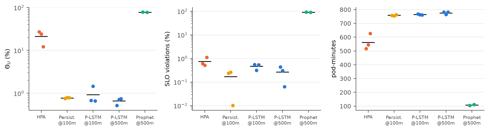
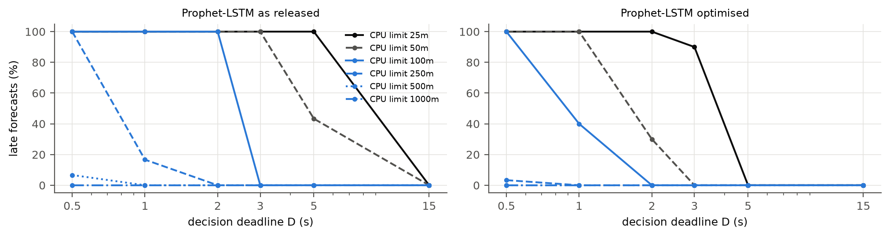
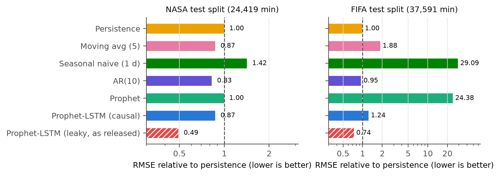
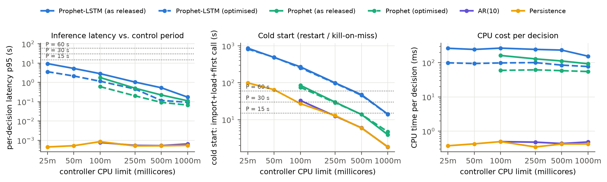
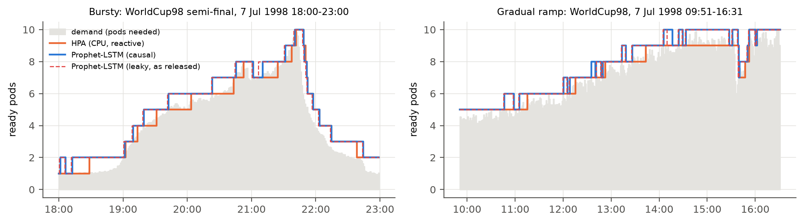
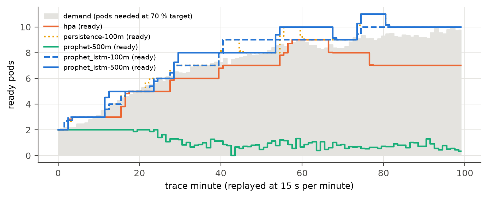

# Cutoff 3 — Methodology, experiments and final results

**Research question.** Can a predictive autoscaler built on a Prophet–LSTM hybrid fit within a Kubernetes
controller's CPU budget, produce *timely and causally valid* forecasts, and improve scaling decisions
compared with the reactive HPA?

This directory holds the complete experimental framework, the raw results and the C3 report:

| Path | Content |
|---|---|
| `pbscale/` | Python library: trace loading and scenarios (`data.py`), causal forecasters (`forecasters.py`), metrics (`metrics.py`), trace-driven autoscaling simulator (`simulate.py`) |
| `scaler/` | Budget-aware **KEDA external scaler** (gRPC): `server.py` (control loop, Prometheus query, gRPC API), `budget.py` (forecaster in a worker process, deadline, kill-and-fallback, cgroup CPU accounting), `Dockerfile` |
| `app/` | CPU-bound workload service (standard library only) exporting Prometheus counters |
| `loadgen/replay.py` | Open-loop trace replayer (Poisson arrivals, time-compressed) |
| `k8s/` | kind cluster config, Prometheus, workload, HPA baseline, scaler + `ScaledObject` template, vendored KEDA 2.16.1 / metrics-server 0.7.2 manifests |
| `experiments/` | E1–E5 experiment scripts, `make_figures.py`, `make_architecture.py` |
| `scripts/` | Image build, E4 repetitions (`run_e4_reps.sh`), low-budget E2 (`run_e2_lowbudget.sh`) |
| `models/` | Trained models (70 % training split) |
| `results/` | Raw outputs (JSON/CSV/logs) of every experiment |
| `figures/` | Figures (PDF + PNG) generated from `results/` |
| `report/` | C3 report (LaTeX, Overleaf-ready) and generated tables |
| `tests/` | Smoke test of the budget-enforcement mechanism |

## Experimental design

### Compared autoscalers (all share one replica policy)

| | Signal | Implementation |
|---|---|---|
| **B1 – HPA** | observed CPU utilisation (reactive) | `k8s/hpa.yaml`, target 70 % of the CPU request |
| **B2 – Prophet scaler** | Prophet forecast of the request rate at *t+1* | KEDA external scaler, `MODEL=prophet` |
| **Proposed – budgeted Prophet–LSTM** | hybrid forecast at *t+1*, **under a CPU limit (100m–500m) and a deadline (= control period)**; late → persistence fallback, worker killed and restarted | KEDA external scaler, `MODEL=prophet_lstm` |
| Light references | persistence, moving average, seasonal naive, AR(10) | same scaler / simulator |

All autoscalers use the same rule `replicas = ceil(signal / (C · 0.7))`, the same 10 % tolerance and the
same scale-down stabilisation window (5 control periods). The only difference between them is the input
signal. C is the pod capacity in requests per second at 100 % of the CPU request.

### How the CPU budget and time budget are enforced
* **CPU budget** = `resources.limits.cpu` of the scaler Pod (CFS quota): the same mechanism Kubernetes uses
  for every controller. In E2 the same quota is applied with `docker run --cpus`.
* **Time budget**: every control period the forecast is requested from a worker process and awaited for at
  most `DEADLINE_S`, which defaults to the control period. If no answer arrives in time, the decision uses the
  persistence fallback `y(t)`, the worker is SIGKILLed and re-spawned, and the period is logged as *late*.
* **Accounting**: CPU time per forecast (`time.process_time`, all threads), wall latency, worker RSS, and the
  container's cgroup `cpu.stat` counters (usage and CFS throttling) are logged as one JSON line per decision.

### Causal evaluation (fixes C2 findings F1/F2)
The forecast for minute *t+1* uses only observations up to *t*. Residual scalers are fitted on the training
split only. The base paper's mis-aligned evaluation is kept as an explicitly labelled *leaky* variant, so that
its effect on accuracy and on scaling quality can be measured.

### Workload scenarios
All scenarios come from the held-out 30 % test split of each trace.

| Scenario | Trace | Window | Character |
|---|---|---|---|
| `steady` | NASA-HTTP | Sat 26 Aug 1995, 24 h | low, smooth weekend load |
| `diurnal` | NASA-HTTP | Tue 22 Aug 1995, 24 h | weekday rise and fall |
| `ramp` | WorldCup98 | 7 Jul 1998 09:51–16:31 | gradual ramp; the base paper's autoscaler slice |
| `bursty` | WorldCup98 | 7 Jul 1998 18:00–23:00 | semi-final flash crowd, 22k → 226k req/min |

### Metrics
* **Forecast quality (t+1, causal):** RMSE, MAE, R², sMAPE.
* **Controller overhead:**
  * CPU ms per decision;
  * p50/p95/max decision latency;
  * cold start (import + load + first call);
  * RSS;
  * CFS throttling;
  * share of the period's CPU budget used;
  * cost of re-fitting the model within the budget.
* **Scaling quality:**
  * Θ_U, Θ_O, T_U, T_O (definitions in `pbscale/metrics.py`);
  * pod-minutes;
  * share of time saturated;
  * live only: request SLO violations (error, timeout, or latency > 500 ms).
* **Timeliness:** inference latency against the control period (15/30/60 s), late-forecast fraction, and
  cold-start periods.

## Experiments

| ID | What | Script | Output |
|---|---|---|---|
| E1 | Train on 70 %, causal vs. leaky accuracy on the full test split | `experiments/e1_train_and_accuracy.py nasa\|fifa` | `results/e1_*` |
| E2 | Controller overhead under CPU limits 25m/50m (hybrid, persistence)/100m/250m/500m/1000m/unlimited | `experiments/e2_overhead.py` | `results/e2_overhead.json`, `results/e2/raw/` |
| E3 | Trace-driven HPA vs. predictive scaling, 4 scenarios, budget-induced late forecasts | `experiments/e3_simulate.py` | `results/e3_*` |
| E4 | Live kind cluster: HPA vs. KEDA Prophet vs. KEDA persistence (100m) vs. KEDA Prophet–LSTM (500m, 100m); load-generator seeds 1–3 | `experiments/e4_live.py`, `e4_analyze.py`, `scripts/run_e4_reps.sh` | `results/e4/`, `results/e4_live.json` |
| E5 | Statistics: moving-block bootstrap CIs (E3), decision equivalence with persistence, deadline sensitivity (E2), aggregation of E4 seeds | `experiments/e5_statistics.py` | `results/e5_statistics.json`, `report/tables/e5_*.tex` |

## Reproduction

Requirements: Linux, Docker, about 6 GB of free RAM, [uv](https://github.com/astral-sh/uv),
[kind](https://kind.sigs.k8s.io) v0.27 and kubectl v1.32.

```bash
cd cutoff3
# 0. data + Python environment (same pinned versions as Cutoff 2)
git clone https://github.com/pasanbhanu/time-series-forcasting-with-facebook-prophet-lstm-hybrid-model upstream/repo
uv venv --python 3.11 venv && VIRTUAL_ENV=$PWD/venv uv pip install -r ../cutoff2_reproduction/requirements.lock.txt grpcio-tools psutil
# E1 (~10 min): trains models/ and writes accuracy tables
for t in nasa fifa; do venv/bin/python experiments/e1_train_and_accuracy.py $t; done
# images + cluster
kind create cluster --config k8s/kind-config.yaml
kubectl apply -f k8s/vendor/metrics-server-0.7.2.yaml
kubectl apply --server-side -f k8s/vendor/keda-2.16.1.yaml
kubectl apply -f k8s/prometheus.yaml -f k8s/app.yaml
./scripts/build_images.sh
# E2 (~1 h, runs CPU-limited containers; keep the machine otherwise idle)
venv/bin/python experiments/e2_overhead.py --n 30
# E3 (~3 min)
venv/bin/python experiments/e3_simulate.py
# E4 (~2 h; capacity C from the calibration step, see report §Setup)
venv/bin/python experiments/e4_live.py --capacity <C>
venv/bin/python experiments/e4_analyze.py
# E4 repetitions (seeds 2, 3 + persistence control; ~5 h) and E2 at 50m/25m (~2 h)
./scripts/run_e4_reps.sh && ./scripts/run_e2_lowbudget.sh
venv/bin/python experiments/e2_overhead.py --summarize-only && venv/bin/python experiments/e4_analyze.py
# E5 statistics, figures + LaTeX tables
venv/bin/python experiments/e5_statistics.py
venv/bin/python experiments/make_figures.py
venv/bin/python experiments/make_architecture.py
```

## Final results (Day-80 draft)

### E4 — live, mean ± sd over load-generator seeds 1–3 (Prophet: 2 seeds)

| Autoscaler | Θ_U (%) | T_U (%) | pod-min | SLO viol. (%) | late | ready after (s) |
|---|---|---|---|---|---|---|
| B1: HPA (CPU 70 %) | 21.10 ± 7.93 | 91.0 ± 10.6 | 563 ± 57 | 0.74 ± 0.32 | — | — |
| B2: Prophet @500m | 77.58 ± 0.63 | 99.0 ± 0.0 | 107 ± 5 | 90.76 ± 1.11 | 0 % | 22 ± 3 |
| Persistence @100m | 0.78 ± 0.02 | 20.7 ± 1.5 | 759 ± 4 | 0.17 ± 0.14 | 0 % | 86 ± 3 |
| Prophet–LSTM @100m | 0.93 ± 0.45 | 19.0 ± 4.4 | 764 ± 4 | 0.47 ± 0.13 | 0 % | 356 ± 25 |
| Prophet–LSTM @500m | 0.66 ± 0.13 | 15.0 ± 1.0 | 776 ± 10 | 0.27 ± 0.19 | 0 % | 56 ± 7 |

* Every request-rate scaler beats the HPA in every seed (paired Θ_U −11 to −27 pp).
* Hybrid minus persistence, paired by seed: −0.12, −0.08, +0.66 pp at 100m; −0.03 to −0.24 pp at 500m with 1–3 %
  more pod-minutes. The hybrid had slightly more SLO violations than persistence in all six pairs.
* No hybrid forecast was late in any of the six runs.

### E2 at very low budgets
At 25m the as-released hybrid needs 263 ms CPU per decision (p95 9.5 s, still inside a 15 s period), but its cold
start is 868 s. At 50m the p95 is 5.3 s and the cold start 487 s. Persistence stays below 1 ms per decision at any budget.




## Preliminary results (single run per configuration)

Full write-up: [`report/c3_methodology_preliminary_results.tex`](report/c3_methodology_preliminary_results.tex)
(Overleaf-ready; figures are taken from `../figures/`).

### E1 — Causal vs. leaky accuracy (t+1, full test split, raw req/min)

| Forecaster | NASA RMSE | FIFA RMSE |
|---|---|---|
| Persistence | 16.40 | 763 |
| Moving average (5) | 14.32 | 1431 |
| AR(10) | **13.58** | **728** |
| Prophet | 16.37 | 18599 (R² 0.02) |
| Prophet–LSTM, **causal** | 14.32 | 944 |
| Prophet–LSTM, *leaky* (base paper's protocol) | 8.10 | 564 |

Leakage makes the hybrid's RMSE look 40–43 % lower than it really is. The leaky residual "forecast"
correlates at 0.9997 with the residual of the same row. Under the causal protocol, the hybrid is beaten by
AR(10) on both traces and by persistence on FIFA.



### E2 — Controller overhead under CPU budgets (FIFA models, 30 decisions each)

| Forecaster | Limit | CPU/decision | p95 latency | Cold start | RSS |
|---|---|---|---|---|---|
| Prophet–LSTM (as released) | 100m | 266 ms | 2.86 s | 270 s | 0.7 GB |
| Prophet–LSTM (as released) | 500m | 233 ms | 0.53 s | 48 s | 0.7 GB |
| Prophet–LSTM (optimised) | 100m | 98 ms | 1.15 s | 254 s | 0.7 GB |
| Prophet (as released) | 100m | 162 ms | 1.80 s | 85 s | 0.17 GB |
| AR(10) / persistence | 100m | ≈0.5 ms | — | 27–33 s | 0.09 GB |

* There are **no late forecasts** for any budget and control period (15/30/60 s). Inference fits easily.
* The binding costs are elsewhere:
  * cold start: 18 control periods at 100m, so kill-and-restart is dangerous at low budgets;
  * memory;
  * re-fitting: one LSTM epoch takes 136 s at 100m, so periodic re-training cannot share the controller budget.



### E3 — Trace-driven scaling (4 scenarios, shared replica policy)

* On `ramp`/`bursty`, every request-rate scaler (persistence, AR(10), causal hybrid) reduces Θ_U from
  0.84–1.43 % (HPA) to ≈0.1 %, and time under-provisioned from 23–30 % to 3–4.5 %, for 5–8 % more pod-minutes.
* **Persistence gets the same gain.** The benefit comes from the request-rate signal, not from forecasting.
* Prophet alone misses the flash crowd: Θ_U = 58 %, and demand exceeds capacity in 77 % of minutes.
* Leaky forecasts make the hybrid's scaling look 3–13× better than it really is.



### E4 — Live kind cluster, `bursty` slice (100 trace minutes at 15 s/min, 29,961 requests)

| Autoscaler | Θ_U (%) | T_U (%) | pod-min | SLO viol. (%) | CPU/dec. | p95 lat. | late |
|---|---|---|---|---|---|---|---|
| B1: HPA (CPU 70 %) | 12.12 | 79 | 627 | 1.11 | — | — | — |
| B2: KEDA Prophet @500m | 77.13 | 99 | 111 | 89.97 | 78 ms | 0.17 s | 0 % |
| KEDA Prophet–LSTM @100m | 0.66 | 16 | 761 | 0.54 | 230 ms | 2.59 s | 0 % |
| KEDA Prophet–LSTM @500m | 0.75 | 14 | 781 | 0.06 | 158 ms | 0.33 s | 0 % |

* **Feasibility.** The budgeted hybrid runs live even at 100m: 0 late decisions and 36 % of the CPU quota
  used. Cold start was 328 s at 100m vs. 48 s at 500m.
* **Gain over the HPA.** The hybrid beats the HPA on under-provisioning and SLO violations, for 21–25 % more
  pod-minutes. However, its live t+1 forecast has the *same* RMSE as persistence (2.23 vs. 2.23 req/s).
* **Prophet alone.** Prophet never scaled out, and 54 % of requests failed.



**Limitations.**
* There is one repetition per configuration and one live scenario, on a single-node cluster that shares the
  host with its load generator.
* Time is compressed: 1 trace minute = 15 s.
* The deadline/kill path never triggered under these conditions; it was exercised only in `tests/smoke_budget.py`.

These will be addressed with repeated runs and confidence intervals before the final paper.

## Troubleshooting log

| Problem | Cause | Fix |
|---|---|---|
| The first "predictive" live run was in fact a CPU HPA | KEDA called `GetMetricSpec` before the gRPC scaler was listening, then created an HPA with only a default CPU metric and never retried | `e4_live.py` applies the `ScaledObject` only after the scaler is ready, and aborts unless the HPA contains an `External` metric; the invalid run was discarded |
| A per-pod target of 2.8 req/s became 2 | KEDA 2.16 uses the integer `targetSize` | The metric is exported in milli-req/s (`forecast_mrps`, target 2800) |
| Manifest rendering failed | A `${...}` inside a YAML comment of the `string.Template` | The comment was removed and the run repeated |
| Noisy capacity calibration | Model training ran in parallel | All calibration and timing runs were repeated on an idle host |
| TensorFlow could not be installed | Host Python 3.15 has no wheels | Isolated Python 3.11 (uv) and container images are used |
| `e4_analyze.py` produced empty run names | `basename()` of a path with a trailing slash | `rstrip("/")` |

Further defects found in the released KEDA scaler (in addition to C2 F1–F6):
* **F7:** a unit mismatch (req/s vs. req/min, with `scaleFactor` 100 instead of 60);
* **F8:** the residual is computed against the forecast for t+1 instead of t;
* **F9:** `int()` truncation of the pod count.
